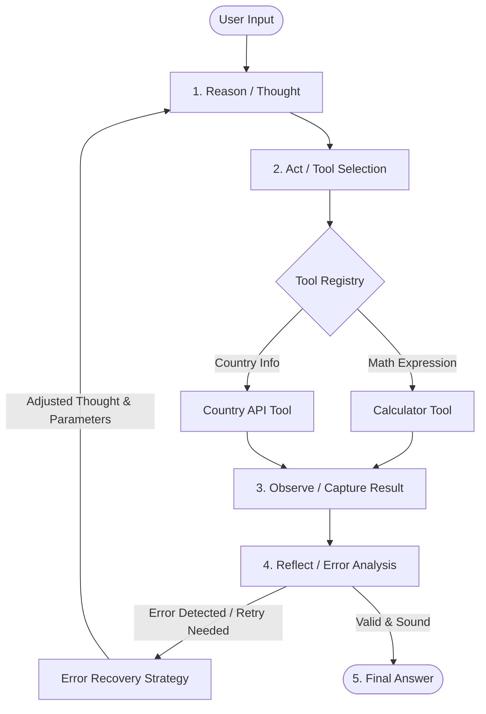

# Custom ReAct Engine (Reason + Act + Observe + Reflect)

A modular, lightweight, and extensible **ReAct (Reasoning + Acting) Agent Engine** with **Reflection & Error Recovery** built in Python.

---

## 📌 Project Overview

Traditional LLM workflows often rely on standard prompt-completion or pure Chain-of-Thought (CoT). While CoT reasons step-by-step, it lacks the ability to interact with real-world environments, verify facts dynamically, or recover from errors.

The **ReAct (Reasoning + Acting)** framework synergizes reasoning traces and task-specific actions. This project implements a custom ReAct Engine augmented with an explicit **Reflection & Self-Correction Loop**:

1. **Reason (Thought):** Understand user intent, analyze constraints, and determine the next action.
2. **Act (Action):** Invoke tools (e.g., Safe AST Calculator or REST Countries API).
3. **Observe (Observation):** Collect raw execution outputs, status codes, or errors.
4. **Reflect (Reflection):** Evaluate whether the observation is valid, complete, and answers the query. If an error is detected, formulate a critique and suggest corrective actions (retry with alternative parameters or fallback).
5. **Final Answer:** Synthesize the verified result into a clean, human-readable response.

---

## 🏗️ Architecture & Workflow



---

## 📂 Project Structure

```text
Custom-ReAct-Engine/
│
├── main.py              # CLI entry point, menu, and automated test runners
├── tools.py             # Calculator (AST safe evaluation) and Country API tools
├── reflection.py        # Error detection, output validation, and recovery strategies
├── agent.py             # ReAct control loop (Reason -> Act -> Observe -> Reflect)
├── requirements.txt     # Python dependencies
└── README.md            # Complete project documentation & Viva preparation guide
```

### 📄 Har File Ka Kaam (File Responsibilities)

| File | Kaam (Role) | Description |
| :--- | :--- | :--- |
| **`main.py`** | **Program Run Karna** | Interactive console interface, menu options (1–6), CLI flags (`--test`, `--query`), and color-coded execution logs. |
| **`tools.py`** | **Calculator Aur API Tools** | Contains `CalculatorTool` (safe AST evaluation without unsafe `eval`) and `CountryAPITool` (REST Countries API consumer with offline fallback database). |
| **`reflection.py`** | **Errors Detect Aur Recover Karna** | Inspects tool observations, detects syntax errors, zero division, 404 not found, or network timeouts, and suggests corrective retries. |
| **`agent.py`** | **ReAct Control Loop** | Core loop coordinating Thought $\to$ Action $\to$ Observation $\to$ Reflection $\to$ Final Answer, tracking trajectories and preventing infinite loops. |
| **`requirements.txt`** | **Dependencies** | Python external packages (`requests`, `colorama`). |
| **`README.md`** | **Documentation & Viva Prep** | Project architecture, usage instructions, working examples, and viva exam questions. |

---

## ⚙️ Installation & Setup

### Step 1: Clone or Open Project Directory
```powershell
cd Custom-ReAct-Engine
```

### Step 2: Create a Virtual Environment (Optional but Recommended)
```powershell
python -m venv venv
.\venv\Scripts\activate
```

### Step 3: Install Dependencies
```powershell
pip install -r requirements.txt
```

---

## 🚀 Running the Project

### 1. Interactive Menu Mode
Run the main program to launch the interactive terminal dashboard:
```powershell
python main.py
```
Menu options:
- `1`: Run Example 1 (Calculator)
- `2`: Run Example 2 (REST API)
- `3`: Run Example 3 (Error Recovery via Reflection)
- `4`: Custom Question (Enter your own query)
- `5`: Run All Automated Tests
- `6`: Exit

### 2. Automated Test Mode
Run all 3 core project examples in sequence:
```powershell
python main.py --test
```

### 3. Single Query CLI Mode
Pass a query directly from the terminal:
```powershell
python main.py --query "What is 25 * 4?"
python main.py --query "Tell me information about Pakistan."
```

---

## 🔍 Working Examples (Live Trace Logs)

### Example 1: Calculator Tool

**User Input:**
```text
What is 25 × 4?
```

**Agent Process:**
- **Reason:** Mathematical question hai. Calculator tool execute hoga.
- **Act:** Calling tool `calculator` with input `25 * 4`
- **Observe:** Result received: `100`
- **Reflect:** Calculation succeeded. Result '100' is mathematically sound and valid.
- **Final Answer:** `100`

---

### Example 2: REST Countries API Tool

**User Input:**
```text
Tell me information about Pakistan.
```

**Agent Process:**
- **Reason:** Country information chahiye. REST Countries API call karni hai.
- **Act:** Calling tool `country_api` with input `Pakistan`
- **Observe:** Result received: `Pakistan`
- **Reflect:** Country data for 'Pakistan' successfully retrieved and verified.
- **Final Answer:**
  ```text
  Information about Pakistan:
    - Official Name: Islamic Republic of Pakistan
    - Capital: Islamabad
    - Region: Asia (Southern Asia)
    - Population: 220,892,331
    - Area: 881,912 sq km
    - Currencies: Pakistani Rupee (PKR)
    - Languages: Urdu, English
    - Flag: [PK]
  ```

---

### Example 3: Error Recovery via Reflection

#### Scenario A: Typo Recovery (Spelling Error)
**User Input:**
```text
Tell me information about Pakistann
```

**Agent Process:**
1. **[Iteration 1]**
   - **Reason:** Country information chahiye. REST Countries API call karni hai.
   - **Act:** Calling tool `country_api` with input `Pakistann`
   - **Observe:** Error received: `Country 'Pakistann' not found (HTTP 404)`
   - **Reflect:** `Reflect: Target 'Pakistann' failed. Spelling anomaly detected. Suggestion algorithm recommends 'Pakistan'. Initiating retry with corrected parameter.`
   - **Recovery Action:** Error analyze karke retry karega: `country_api` (`Pakistan`)

2. **[Iteration 2]**
   - **Reason:** Previous attempt failed. Reflection advised retry with tool `country_api` and parameter `Pakistan`.
   - **Act:** Calling tool `country_api` with input `Pakistan`
   - **Observe:** Result received: Pakistan verified data.
   - **Reflect:** Country data for 'Pakistan' successfully retrieved and verified.
   - **Final Answer:** Information about Pakistan.

#### Scenario B: Network Endpoint Failure Recovery
**User Input:**
```text
Tell me information about Pakistan. (Simulated Network Outage)
```

**Agent Process:**
1. **[Iteration 1]**
   - **Reason:** REST Countries API call karni hai.
   - **Act:** Tool execution fails due to network timeout (HTTP 504).
   - **Observe:** Error received: `API Connection Timeout: Endpoint unreachable`.
   - **Reflect:** `Reflect: Network endpoint unreachable. Initiating error recovery: retrying via offline verified knowledge base for 'Pakistan'.`
   - **Recovery Action:** Error analyze karke retry karega: `country_api` (`Pakistan`) with offline fallback.

2. **[Iteration 2]**
   - **Act:** Offline knowledge base retrieves verified data.
   - **Observe:** Result received: Pakistan.
   - **Reflect:** Observation valid hai.
   - **Final Answer:** Pakistan details successfully returned.

---

## 🎓 Viva Preparation Questions & Answers

### Q1: What is the ReAct Framework and how does it differ from Chain-of-Thought (CoT)?
> **Answer:** 
> - **Chain-of-Thought (CoT)** prompts language models to reason step-by-step, but reasoning is internal to the model and cannot interact with the external world or fetch live data.
> - **ReAct (Reason + Act)** integrates reasoning traces with action execution. The agent reasons about what to do, takes an action in an external environment (e.g., executing a calculator or API), observes the output, and updates its reasoning based on real observations.

### Q2: Why is the "Reflection" step crucial in an Agent loop?
> **Answer:**
> Without Reflection, an agent blindly accepts whatever a tool returns—even errors, empty payloads, or corrupt data. The **Reflection step**:
> 1. Validates whether the observation satisfies the original goal.
> 2. Detects runtime errors (e.g., Division by Zero, HTTP 404, Network Timeouts).
> 3. Implements **Self-Correction** by altering the query or tool parameters and triggering an intelligent retry instead of halting immediately.

### Q3: How is security handled in the Calculator Tool?
> **Answer:**
> We avoid using Python's built-in `eval()` function because `eval()` can execute arbitrary code (e.g., `__import__('os').system('rm -rf')`). Instead, `CalculatorTool` uses Python's **Abstract Syntax Tree (`ast`)** module to recursively parse and evaluate only safe binary arithmetic operators (`+`, `-`, `*`, `/`, `**`, `%`) and numeric constants.

### Q4: How does the agent prevent infinite loops when tools fail repeatedly?
> **Answer:**
> The `ReActAgent` class enforces a `max_iterations` threshold (default is 3). Each step increments the iteration counter. If the reflection engine cannot validate a response within the maximum allowed iterations, the loop terminates gracefully with an explanatory message.

### Q5: How does Error Recovery work in the Country API Tool?
> **Answer:**
> The Country API tool combines live network requests with two layers of recovery:
> 1. **Fuzzy String Matching (`difflib`):** If a user misspells a country (e.g., `Pakistann`), the reflection engine catches the 404, suggests the closest valid country (`Pakistan`), and triggers a self-correction retry.
> 2. **Offline Fallback Knowledge Base:** If the external REST API is down or the network is unreachable, reflection catches the timeout and seamlessly falls back to a verified offline dataset.

---

## 📤 Upload to GitHub

To push this repository to GitHub:

```powershell
# 1. Initialize git repository
git init

# 2. Add all files
git add .

# 3. Commit files
git commit -m "Initial commit: Custom ReAct Engine with Reflection & Error Recovery"

# 4. Link your GitHub remote repository (replace with your repo URL)
git remote add origin https://github.com/<your-username>/Custom-ReAct-Engine.git

# 5. Push to main branch
git branch -M main
git push -u origin main
```

---

## 📜 License
This project is open-source and created for educational and practical agentic AI engineering.
